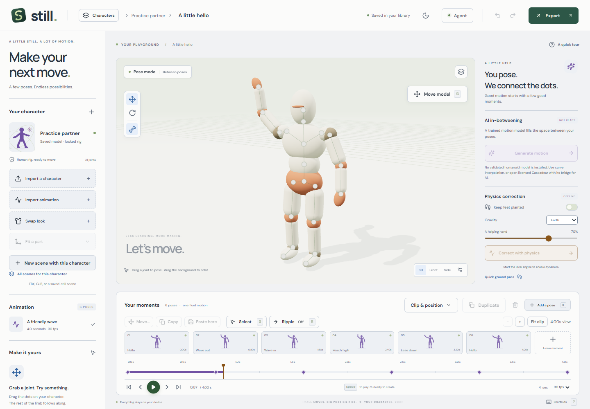

# Still Motion Studio

**Pose, animate and export characters on your own computer.**

Still is a free, open-source character animation editor built with React, Three.js and Electron. Import a rigged character, shape its motion with a few poses or pick from an offline motion library, edit clips and export animation for a game or scene. Core editing runs locally without a cloud account, API key or GPU.

[Download](https://github.com/mrchevyceleb/still-motion-studio/releases/latest) · [User guide](docs/user-guide.md) · [Development](docs/development.md) · [Contributing](CONTRIBUTING.md)



## What you can do

- Import rigged FBX/GLB characters and compatible animation clips; preserve joints and skin weights.
- Browse 310 offline CC0 motion clips for human, quadruped and creature rigs, preview them on your character, then apply or append with one-step Undo. Keep your own downloaded FBX, GLB and BVH clips in **My Motions**.
- Fit a rig to a neutral-pose character, including editable hand and finger joints, hydra heads, serpents and tentacles.
- Import BVH motion and map joints from other animation libraries. See [creature workflows and limits](docs/creature-animation.md).
- Pose joints, edit keyframes, copy selected properties, ripple timing and undo bulk edits.
- Trim, blend, repeat and reverse clips. Keep a local character library with independent scenes and backups.
- Export portable `.still` projects, animated GLB, and Unreal FBX packages with optional root motion and body retargeting.
- Drive the editor through a local authenticated SDK or MCP server.
- Add optional MuJoCo physics and a small learned animal-motion prior. Optionally connect your own Meshy account for preset or generated motion.

## Download for Windows

Get the **Still-Motion-Studio-Setup** installer from the [latest release](https://github.com/mrchevyceleb/still-motion-studio/releases/latest). It targets Windows x64 and includes everything Still needs offline (CPU Python, MuJoCo and Blender). Installed copies check public GitHub releases for updates and install one when you choose **Restart and update**; no account or sign-in is needed. The smaller **Update** installer is only for a computer that already has the matching runtime.

Installers are currently unsigned, so Windows SmartScreen may warn on first install. Each release lists `SHA256SUMS.txt` for checking the download. See [desktop setup](docs/desktop.md).

## Run from source

The browser editor works on Windows, macOS and Linux. Install [Node.js 24 LTS](https://nodejs.org/) and Git, then:

```sh
git clone https://github.com/mrchevyceleb/still-motion-studio.git
cd still-motion-studio
npm ci
npm run dev
```

Open **http://127.0.0.1:5173**. The local service uses port 5175. The core editor needs no Python, Blender, pretrained weights or environment file. Optional engines show as unavailable until installed; posing, curve animation, the motion library and GLB export still work. See [development setup](docs/development.md) for native features.

To build the Windows desktop app yourself, follow [build from a fresh clone](docs/desktop.md#build-from-a-fresh-clone).

## Your first animation

1. Start with a built-in practice character or import a rigged FBX/GLB you have permission to use.
2. Move or rotate joints and press **K** to save a pose. Press **Space** to play.
3. Add another pose, pick a clip from the Motion Library, then adjust timing or use clip tools to blend motion.
4. Save a `.still` backup or export animated GLB. Unreal FBX export additionally needs Blender.

Scenes stay in local browser/app storage. Export backups before clearing app data. Desktop can remain in the tray for agent jobs; **Quit Still** stops the service. See the [user guide](docs/user-guide.md), [import guidance](docs/imports.md), [Unreal export](docs/unreal-export.md) and [agent scripting](docs/agent-scripting.md).

## How releases work

Every push to `main` builds and publishes a new Windows release automatically through [GitHub Actions](.github/workflows/release.yml). The version is the next patch number above the newest release, notes come from `docs/releases/v<version>.md` when that file exists (otherwise from the commit list), and the installers, update feed, checksums and matching Blender source archive are uploaded together before the release goes live. Add `[skip release]` to a commit message to skip one. Details are in [development](docs/development.md#releases).

## Current limits

Still is under active development. Review generated motion and exported assets before using them in production.

The animal prior is a small model trained from scratch on documented CC0 motion; its measured improvement over interpolation is modest. No standalone humanoid candidate currently meets the release quality gate. Neither model weights nor training characters are in Git. CondMDI weights are excluded and its research provider is disabled by default because rights remain unresolved.

Difficult acrobatics, hand/prop contacts, moving platforms and unusual anatomy need manual review. Automatic rigging estimates anatomy; it cannot reliably infer hidden or fused fingers. Unreal materials, facial rigs, cloth and gameplay integration remain project-specific. See [motion rights and quality](docs/motion-model-rights.md).

## Contribute

Bug reports, documentation fixes and focused pull requests are welcome. Read [CONTRIBUTING.md](CONTRIBUTING.md) and the [code of conduct](CODE_OF_CONDUCT.md). Report vulnerabilities through [SECURITY.md](SECURITY.md).

```sh
npm run build
npm test
```

CI checks the editor on Windows and Linux. See [development](docs/development.md) for optional Python checks and the project layout.

## License

Original project code is **MIT licensed**: you may use, modify and redistribute it, including commercially, subject to the [license](LICENSE). Dependencies and imported assets retain their own terms; the bundled motion library is CC0. See [THIRD_PARTY_NOTICES.md](THIRD_PARTY_NOTICES.md); no Epic or Cascadeur assets are bundled.
